<p align="center"></p>

<h1 align="center">OpenTerm5</h1>

<p align="center">
  <strong>Your MetaTrader 5 accounts, in a terminal you'll actually enjoy using.</strong><br>
  Open source. Runs natively on Linux, macOS and Windows. No Wine, no VM, no excuses.
</p>

<p align="center">
  <a href="https://github.com/cyenite/OpenTerm5/actions/workflows/ci.yml"></a>
  <a href="LICENSE"></a>
  
  <a href="https://github.com/cyenite/OpenTerm5/releases"></a>
</p>

<p align="center">
  <a href="#-a-quick-tour">Tour</a> ·
  <a href="#-everything-in-the-box">Features</a> ·
  <a href="#-get-it-running">Install</a> ·
  <a href="#-documentation">Docs</a> ·
  <a href="#-contributing">Contribute</a>
</p>

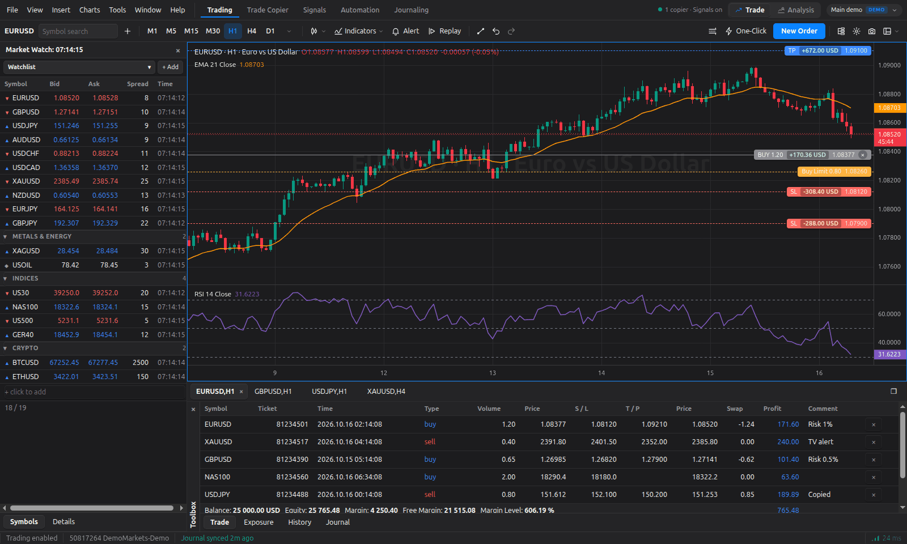

OpenTerm5 connects straight to your broker's MT5 trading servers and gives you the desktop workflow you
already know: Market Watch, charts, the Toolbox, one-click trading. Then it keeps going. The tools traders
usually pay for as Expert Advisors, VPS add-ons or monthly subscriptions come built in:

- 📈 **Charts that feel like TradingView**, drawn by Meridian, OpenTerm5's own chart engine: 86 studies,
  82 drawing tools, layouts of up to 16 synced charts, bar replay, undo and redo.
- 🧪 **Backtesting on replayed history**: trade a simulated account bar by bar, with realistic fills,
  saved sessions and full statistics.
- 🎯 **Risk-based orders.** Say "1% of balance, stop under that low", and OpenTerm5 works out the lots,
  commission included.
- ₿ **Bybit accounts** beside your MT5 ones: trade USDT and USDC perpetuals with the same risk ticket,
  leverage suggested from your stop and liquidation checked before every order.
- 🔁 **A trade copier** between any of your accounts, across brokers, with six sizing modes.
- 🛰️ **A webhook signal API** that turns TradingView alerts and bots into orders.
- 🛡️ **Prop firm guards**: daily loss, max drawdown, request caps and news blackouts, enforced on every
  order from every source.
- 📓 **Automatic journaling** to [Tradescribe](https://tradescribe.io), with a quick review of every
  closed trade.

> [!WARNING]
> **Risk warning.** Trading foreign exchange, CFDs and other leveraged products carries a high level of
> risk and may not be suitable for all investors. OpenTerm5 is provided "as is", without warranty of
> any kind. Test every feature on a demo account before using it with real money. You are responsible
> for every order placed from your accounts.

<sub>OpenTerm5 is an independent open-source project and is not affiliated with, endorsed by or sponsored by MetaQuotes Ltd. See [Licence](#-licence) for trademark notices.</sub>

---

## 🗺️ A quick tour

*All screenshots show a demo account with made-up prices and positions.*

### Analysis mode: just you and the chart

Press <kbd>Ctrl</kbd>+<kbd>Shift</kbd>+<kbd>A</kbd> and the terminal steps aside. The order tickets
leave, the drawing toolbar slides in on the left and your watchlist moves to the right. Your copiers,
signals and guards keep running in the background, so switching modes never stops your automation.

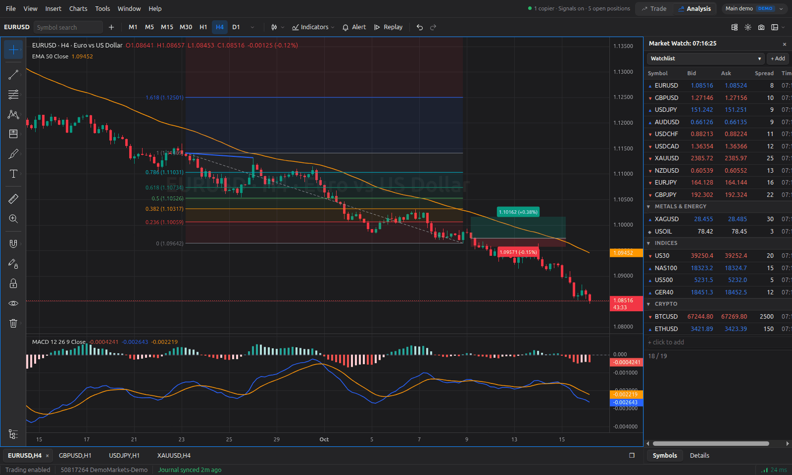

### Drawing tools that behave the way your hands expect

Fibonacci, Gann, pitchforks, channels, patterns, long and short positions, volume profiles: 82 tools in
all, with favourites, a magnet and a floating style bar. The settings dialog works like TradingView's,
down to custom colours, editable levels, templates and visibility per timeframe. Edits show live, and
**Cancel** really does put things back.

<table>
  <tr>
    <td width="50%">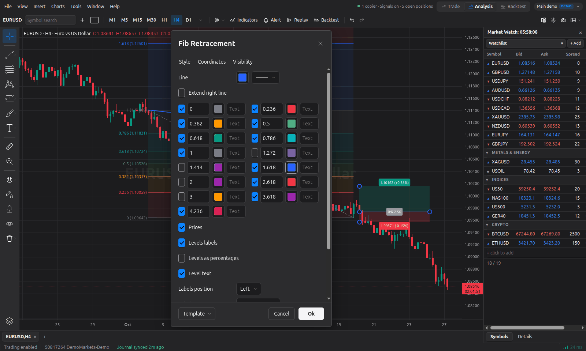</td>
    <td width="50%">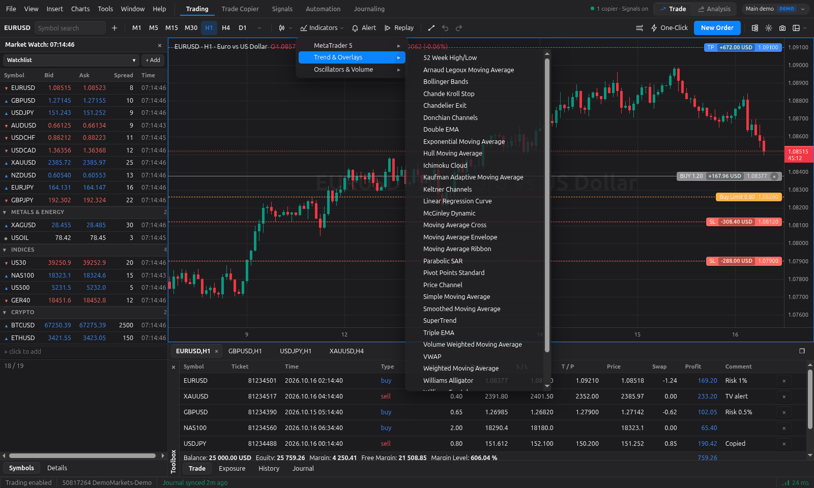</td>
  </tr>
  <tr>
    <td align="center"><sub>TradingView-style drawing settings</sub></td>
    <td align="center"><sub>86 Meridian studies next to MetaTrader's own formulas</sub></td>
  </tr>
</table>

### Lots of charts? Lay them out like TradingView

Every tab in the chart bar is a layout of 1 to 16 charts: pick one of 55 layouts from the layout button,
drag the lines between charts to resize them (Shift moves matching lines together, a double-click
evens them out), and maximise the active chart with <kbd>Alt</kbd>+<kbd>Enter</kbd>.
<kbd>Tab</kbd> moves between charts.

- **Sync in layout:** symbol, interval, crosshair, time and date range, each switched per tab, with
  coloured sync groups for symbol and interval.
- **Sync drawings:** new drawings show on every chart of the same symbol in the tab, or in every tab.
- **One drawing toolbar** down the left for the whole layout. Pick a tool and draw on any chart.

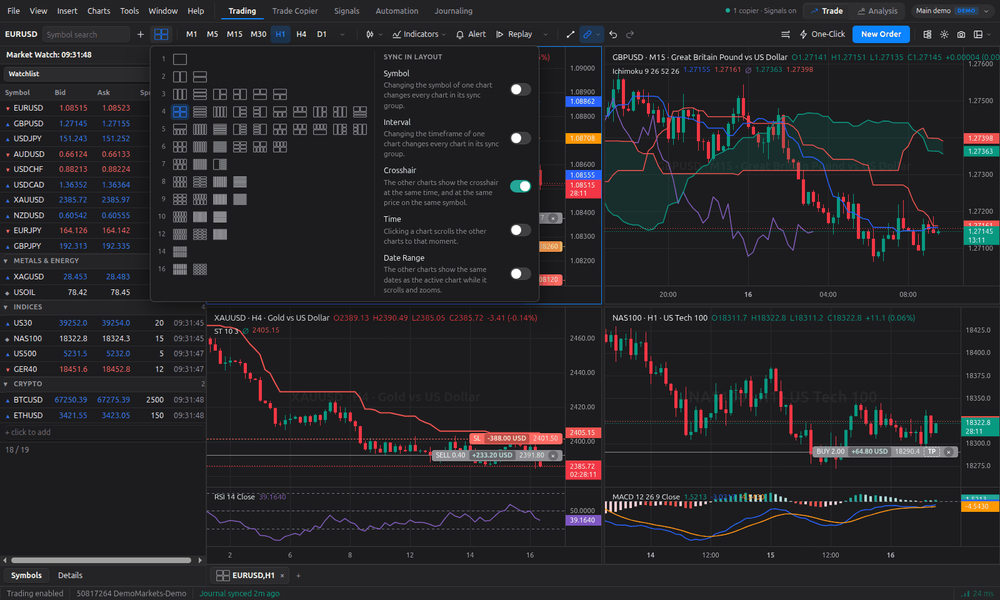

**Bar replay runs the whole layout on one clock.** Pick a start on any chart, then play, step
(<kbd>Shift</kbd>+<kbd>→</kbd>) or change the speed, and every chart moves together. Each shows only
what had happened by then: a chart on a longer timeframe builds its current bar step by step, so H4
and daily candles never give away their own future. Trading from a replaying chart is switched off.

**Backtest with the tools you trade with.** Start a session with a balance, leverage, spread,
slippage and commission in Backtest mode, a third mode beside Trade and Analysis that gives the
interface to the charts and the session, and the layout steps forward through history on its own
clock. Place each order with lines on the
chart: drag the entry, stop loss and take profit, and the volume follows your risk. Orders fill on
the bars passed, stops and targets in the order each bar traded, and gaps at the opening price. Jump to the
next London or New York open, and follow the results in a side panel: R multiples, win rate, profit
factor, drawdown and an equity curve. Sessions save as you go and resume where they stopped.
[How backtesting works](docs/user-guide/backtesting.md).

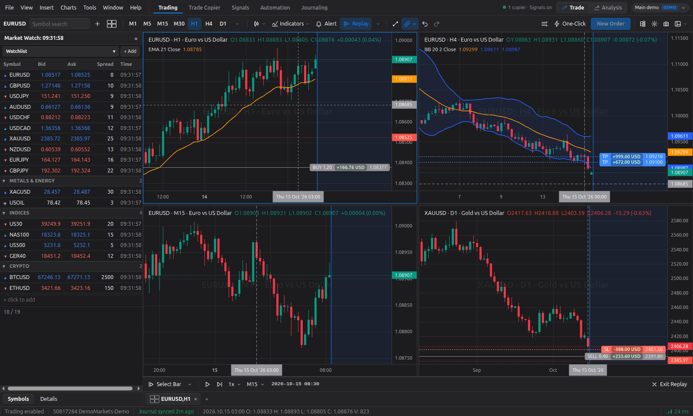

### Size every trade by risk, not by guesswork

Pick **Risk-based** in the order ticket and tell it how much you're willing to lose. OpenTerm5 does the
maths, splits the volume across up to five take-profit levels and can attach break-even and trailing
rules on the way in. Prefer drawing your trades? Drag the risk planner on the chart instead.

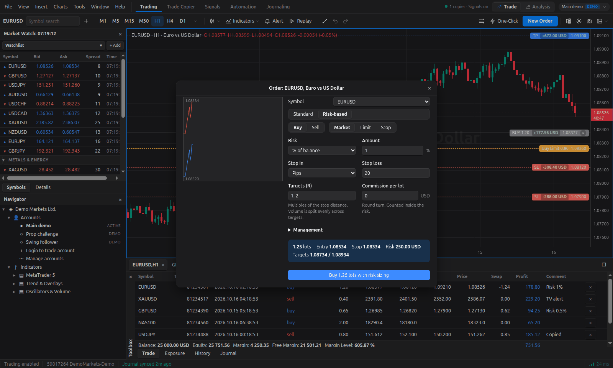

### Crypto perpetuals on Bybit, sized the same way

Log in to a Bybit Unified Trading Account (demo trading, live or testnet) with an API key and trade its
USDT and USDC perpetual and futures contracts from the same terminal. Risk orders size by coin quantity
with Bybit's taker fee counted inside the risk, and split into partial targets that each carry their own
stop. The risk ticket shows the contract's leverage, lets you change it, and suggests one that keeps
liquidation well behind your stop. An order that needs more than your free margin, or whose stop sits
beyond the liquidation price, is refused before anything is sent. Keys that can withdraw funds are
refused too. [How Bybit accounts work](docs/user-guide/accounts-and-brokers.md#bybit-accounts).

### Trade straight from the chart

Positions and pending orders live on the chart, with their profit or loss in money. Drag a stop or a
target to move it, or pull the ghost **TP** and **SL** handles off an entry to add the levels it's
missing. One-Click trading and Depth of Market are a keystroke away.

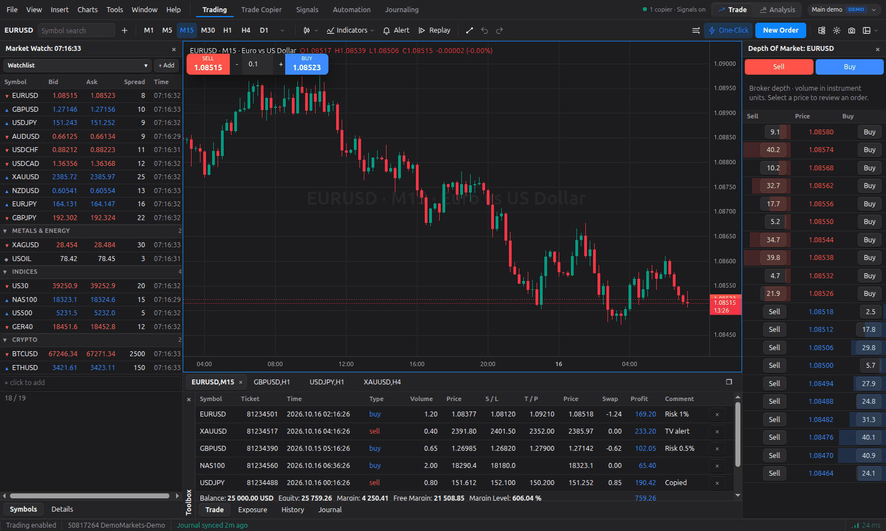

### Trade Copier: one master, as many followers as you like

Copy from one account to any number of others, across brokers. Six sizing modes (fixed lot, lot,
balance or equity multiplier, fixed master balance and fixed % risk), symbol mapping that understands
broker suffixes, filters, trading hours, delays and per-follower equity protection. When a prop firm
asks questions, **Export audit** saves every copy with tickets, times and account logins.

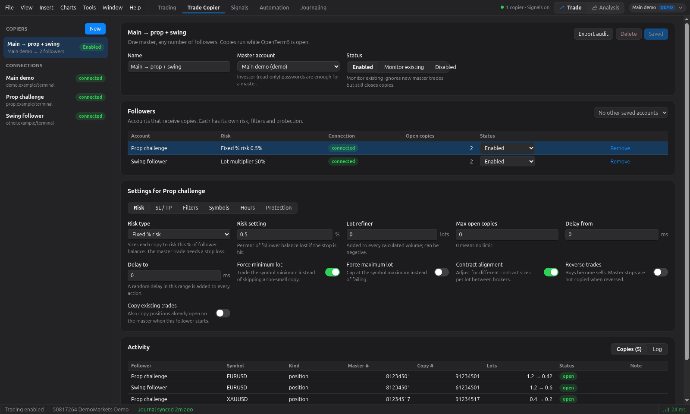

### Signal API: TradingView alerts in, orders out

A local HTTP server for TradingView alerts, bots and scripts. Each source gets its own secret, account,
sizing, allowed symbols and rate limit, with token or HMAC authentication, replay protection,
idempotency keys and a dry-run mode for testing. Results can go to Discord, Slack, Telegram or any
JSON endpoint.

```json
{ "secret": "your-source-secret", "action": "buy", "symbol": "{{ticker}}", "risk": 1, "sl_pips": 20, "tp_r": 2 }
```

Or in plain text, if that's more your style: `buy EURUSD risk=1 sl_pips=20 tp_r=1,2`

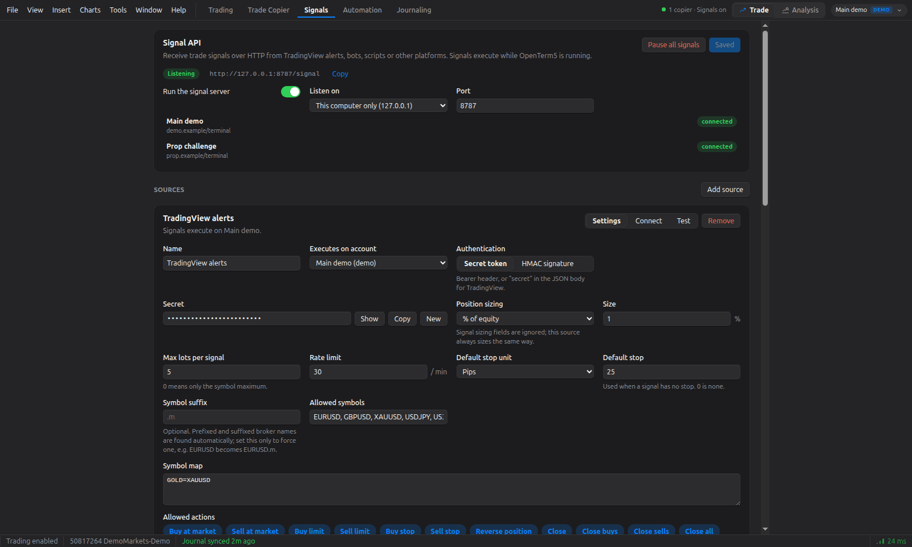

### Prop firm mode: guards that don't blink

Set the rules once and OpenTerm5 enforces them on every order, whether it came from you, the risk
ticket, a webhook or the copier. Daily loss in money or percent, max drawdown, a daily profit lock,
position and lot caps, a cap on trade requests per day (FTMO allows 2,000) and a **news blackout**
around high-impact releases from the ForexFactory calendar. The trading day starts when your firm says
it does: broker server time, Prague, New York, UTC or your own clock.

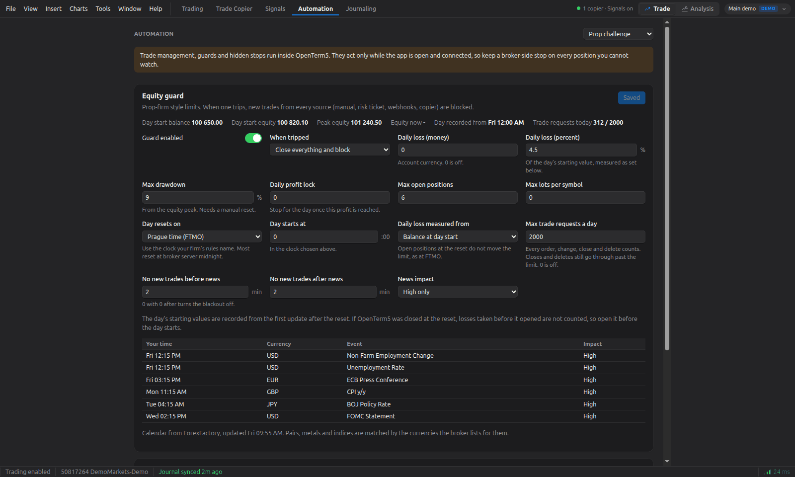

### Journaling: every trade reviewed, zero copy and paste

Connect a [Tradescribe](https://tradescribe.io) journal and your MT5 deals flow in automatically,
marked as verified. Rate trades, tag setups and mistakes, write your day note, and jump into
Tradescribe for the calendar, reports and AI review. Press <kbd>Ctrl</kbd>+<kbd>5</kbd> to open it.

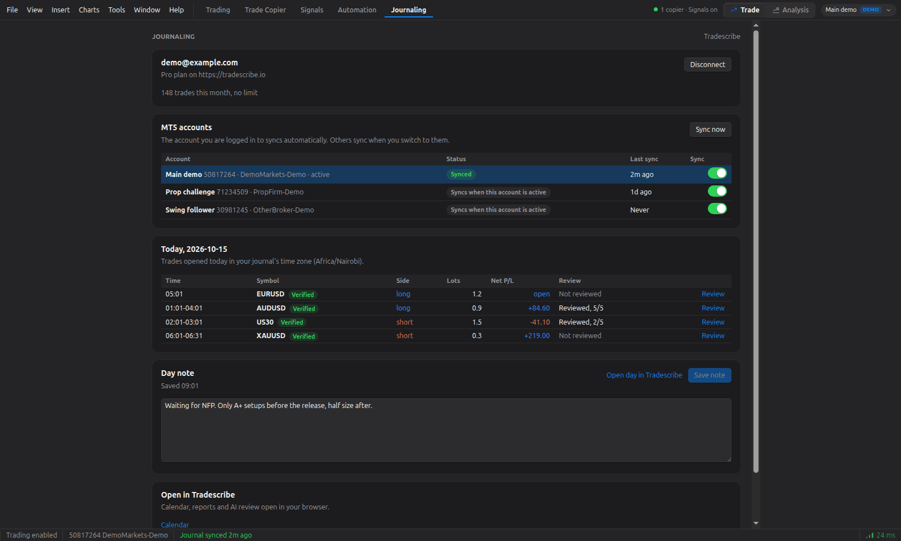

### Log in by server name, and pick your look

Type your broker's server name (`FTMO-Server`, say) and OpenTerm5 finds its address from a list of
about 2,800 MT5 servers. An address it can't verify has to be approved before your password goes
anywhere. Then choose Meridian Dark, Light or Midnight, match your system, or import your saved
TradingView theme.

<table>
  <tr>
    <td width="50%">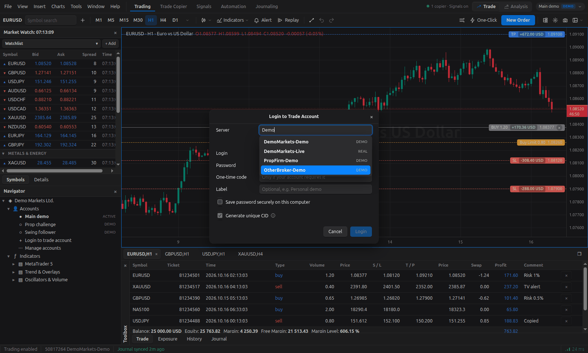</td>
    <td width="50%">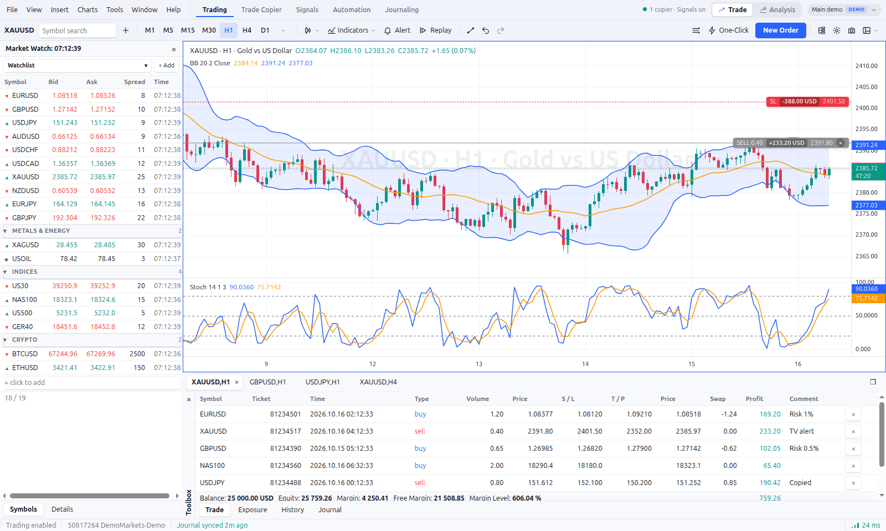</td>
  </tr>
  <tr>
    <td align="center"><sub>Broker search by server name</sub></td>
    <td align="center"><sub>Meridian Light theme</sub></td>
  </tr>
</table>

---

## 🧰 Everything in the box

<details open>
<summary><strong>A complete trading terminal</strong></summary>

- Market Watch with multiple watchlists, foldable sections and as-you-type symbol search that follows
  each broker's symbol names (`EURUSD.m`, `GOLD`), plus a Navigator, Data Window and Depth of Market.
- Toolbox with Trade, Exposure, History (with CSV export) and Journal tabs.
- Market and pending orders, SL/TP modification, partial close, Close By and One-Click trading.
- Orders show their progress as they go: a live timer in the status bar, then the broker's result.
- Bybit accounts (USDT and USDC perpetuals and futures) next to MT5 ones, with their own watchlists
  and risk ticket settings.
- Several saved accounts with one-click switching. Passwords can be kept in your OS keychain.
- Context menus throughout, and the MT5 keyboard shortcuts you already know.

</details>

<details open>
<summary><strong>Charts by Meridian</strong></summary>

- All 21 MT5 timeframes plus S1, S5, S15 and S30 seconds charts.
- Candles, hollow candles, bars, line, area, baseline and Heikin Ashi.
- 86 Meridian studies (DEMA, TEMA, KAMA, ALMA, Ichimoku, SuperTrend, TTM Squeeze, Connors RSI, Fisher
  Transform and many more) next to MetaTrader's own indicator formulas.
- One Indicators dialog, as in TradingView, for every indicator (built-in, MetaTrader and Pine), with
  search, favourites and a favourites menu on the toolbar; `/` opens it.
- Pine Script v5 and v6 indicators, run by [PineTS](https://github.com/LuxAlgo/PineTS): paste a
  TradingView script link (open-source scripts only) or the source, or import TradingView's popular list. Plots, fills (gradients too),
  shapes, bar and background colours, lines, boxes, labels, polylines, tables and `request.security()`
  are drawn; each script keeps its author and licence.
- 82 drawing tools in six groups, with favourites, a magnet, text on lines, templates and per-timeframe
  visibility.
- Layouts of 1 to 16 charts per tab with symbol, interval, crosshair, time, date range and drawing
  sync, and bar replay that runs every chart of a layout on one clock.
- Backtesting sessions: a simulated account with spread, slippage, commission, leverage and stop
  out; orders placed with risk-sized lines on the chart and filled along each bar; R, MAE and MFE
  per trade; statistics, an equity curve and CSV export in a side panel.
- Undo and redo, copy and paste between charts and an object tree.
- Price alerts drawn on the chart, and Chart Settings saved with each chart and its templates.
- Older history loads as you scroll, panes resize and axes drag.
- Profiles and templates, plus Alt shortcuts for the common tools (<kbd>Alt</kbd>+<kbd>T</kbd> trend
  line, <kbd>Alt</kbd>+<kbd>F</kbd> Fibonacci, and so on).

</details>

<details open>
<summary><strong>Risk and automation</strong></summary>

- Size orders by % of balance, % of equity or a fixed amount, with commission counted inside the risk.
- Stops as a price or a distance in points, pips or % of the price, in the risk ticket and as a signal
  source's default.
- On Bybit, leverage shown and set from the risk ticket, a suggested leverage that keeps liquidation
  behind the stop, and margin and liquidation checks before every order.
- Split a position across up to five take-profit levels.
- Manage open positions with break-even, trailing stops, partial targets, hidden stops and time exits.
- One-click bulk actions: close all, close winners or losers, close by side or symbol, delete pending
  orders, move every stop to break-even.
- Equity guards per account: daily loss, max drawdown, profit lock, exposure caps, daily request caps
  and news blackouts.

</details>

<details open>
<summary><strong>Connections and imports</strong></summary>

- **Trade Copier:** master to any number of followers, across brokers, with an audit export.
- **Signal API:** a local webhook server for TradingView alerts and bots, with notifications to
  Discord, Slack, Telegram or JSON.
- **Import from TradingView:** bring over your drawings (placed on your broker's bars, daylight saving
  included), drawing templates, chart themes and chart settings.
- **Journaling:** automatic, verified trade sync to Tradescribe, with in-app reviews.

</details>

---

## 🚀 Get it running

Grab an installer for Windows, macOS (Apple Silicon) or Linux (AppImage or `.deb`) from the
[releases page](https://github.com/cyenite/OpenTerm5/releases). The
[Getting started guide](docs/getting-started.md) lists the files and what to do about first-launch
warnings while builds aren't code-signed yet.

Prefer to build it yourself? You'll need [Node.js 22.12 or later](https://nodejs.org/):

```bash
git clone https://github.com/cyenite/OpenTerm5.git
cd OpenTerm5
npm ci
npm run dev
```

Then choose **File → Login to Trade Account**, search for your broker's server and log in. Start with
a demo account and have a play.

### A few shortcuts worth learning first

| Keys | What it does |
|---|---|
| <kbd>F9</kbd> | New order |
| <kbd>Ctrl</kbd>+<kbd>1</kbd> to <kbd>Ctrl</kbd>+<kbd>5</kbd> | Trading, Trade Copier, Signals, Automation, Journaling |
| <kbd>Ctrl</kbd>+<kbd>Shift</kbd>+<kbd>A</kbd> | Switch between trading and analysis mode |
| <kbd>Ctrl</kbd>+<kbd>Z</kbd> / <kbd>Ctrl</kbd>+<kbd>Y</kbd> | Undo and redo on the chart |
| <kbd>Alt</kbd>+<kbd>B</kbd> | Depth of Market |

The full list is in [Keyboard shortcuts](docs/user-guide/keyboard-shortcuts.md).

## 📚 Documentation

| Guide | Contents |
|---|---|
| [Getting started](docs/getting-started.md) | Install, build, log in and find your way around |
| [Trading](docs/user-guide/trading.md) | Charts, layouts, orders and trading from the chart |
| [Accounts and brokers](docs/user-guide/accounts-and-brokers.md) | Logging in, saved accounts, broker detection and Bybit accounts |
| [Backtesting](docs/user-guide/backtesting.md) | Backtest sessions, placing orders, fills and statistics |
| [Risk and automation](docs/user-guide/risk-and-automation.md) | Risk-based orders, position management and equity guards |
| [Trade Copier](docs/user-guide/trade-copier.md) | Copying trades between accounts |
| [Signal API](docs/user-guide/signal-api.md) | Webhook reference for TradingView and bots |
| [Keyboard shortcuts](docs/user-guide/keyboard-shortcuts.md) | Shortcut reference |
| [Troubleshooting](docs/troubleshooting.md) | Common problems and their fixes |
| [Architecture](docs/development/architecture.md) | How OpenTerm5 is built |
| [Roadmap](docs/roadmap.md) | Known gaps and planned work |

## ⚙️ How it works

OpenTerm5 is an [Electron](https://www.electronjs.org/) application written in TypeScript, with a React
interface. Charts are drawn by Meridian (`packages/meridian-charts`), OpenTerm5's own canvas chart
engine and theme system.

The main process contains an independent client for the protocol that MT5 web trading uses, and keeps
one broker session per account. Bybit accounts connect through Bybit's REST and WebSocket APIs behind
the same interface, so the rest of the app treats them like any other account. The trade manager, trade copier and signal engines run alongside it, so
they keep working while you use the interface. They do need OpenTerm5 to be running and connected, so
keep a broker-side stop on anything you can't watch. See [Architecture](docs/development/architecture.md)
for the details.

## 🧪 Project status

OpenTerm5 is young software. Its behaviour has been verified against the MetaQuotes demo server, and
brokers including FTMO and Pepperstone have been confirmed reachable. Margin figures, some MT5 features
and broader broker coverage are still in progress. The [roadmap](docs/roadmap.md) lists what's missing.
Reports from other brokers are very welcome.

## 🤝 Contributing

Contributions of every size are welcome: bug reports, broker compatibility reports, documentation and
code. Read the [contributing guide](CONTRIBUTING.md) to get started, and follow the
[code of conduct](CODE_OF_CONDUCT.md). Please report security issues privately as described in
[SECURITY.md](SECURITY.md).

If OpenTerm5 saves you a subscription or two, a ⭐ on the repo is a lovely way to say thanks.

## 📄 Licence

OpenTerm5 is released under the [GNU Affero General Public License v3.0](LICENSE) (AGPL-3.0-only).
Versions up to and including 0.3.0 were released under the MIT License and remain available under it.
The move to AGPL lets OpenTerm5 run Pine Script indicators with [PineTS](https://github.com/LuxAlgo/PineTS),
which is itself AGPL-3.0. Third-party components and their licences are listed in
[THIRD_PARTY_NOTICES.md](THIRD_PARTY_NOTICES.md).

Pine Script indicators you import keep their own authors' licences. OpenTerm5 shows each script's
licence and author when you import it; the script is stored on your computer only.

MetaTrader and MetaQuotes are trademarks of MetaQuotes Ltd. TradingView is a trademark of TradingView,
Inc. OpenTerm5 is an independent project and is not affiliated with, endorsed by or sponsored by
MetaQuotes Ltd., TradingView, Inc. or any broker.
